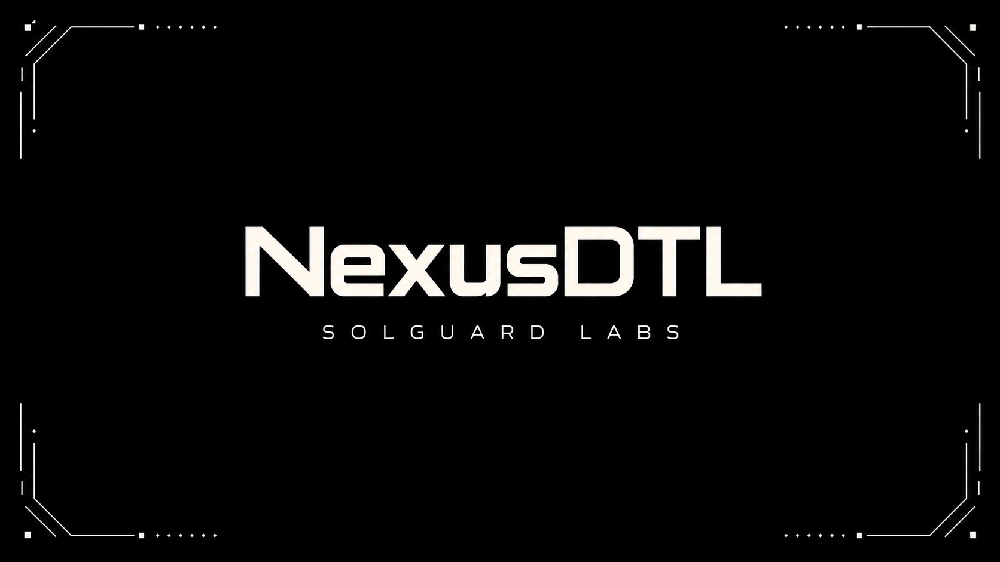
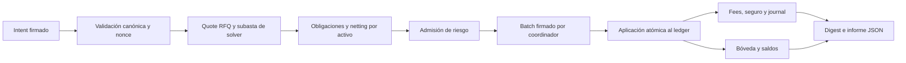

# NexusDTL



NexusDTL coordina liquidaciones programables entre cuentas, proveedores de liquidez, operadores y solvers. Su motor Rust mantiene un libro determinista de saldos y eventos; la CLI produce informes JSON reproducibles para seguimiento de rutas RFQ, crédito, subastas, netting, tesorería y bóvedas. La versión `1.0.0` se distribuye como motor local, sin dependencia de una red o custodia externa.

## Recorrido de una liquidación



El batch vincula red, época, coordinador, solver, bóveda, digest de intents, snapshot de liquidez y digest de netting. El estado se clona antes de ejecutar y solo se confirma tras superar las validaciones. Los tipos fuertes distinguen cuentas, activos, bóvedas y transacciones.

## Componentes económicos

| Dominio                  | Responsabilidad                                           |
| ------------------------ | --------------------------------------------------------- |
| `market/`, `auction/`    | Intents, quotes, lanes y selección de bids.               |
| `netting/`               | Equilibrio de débitos y créditos por activo.              |
| `risk/`                  | Límites de batch y lectura de estrés de reserva.          |
| `vault/`                 | Depósitos, shares, tickets de salida y saldos de reserva. |
| `credit/`                | Facilities, deuda principal e interés devengado.          |
| `treasury/`              | Fees, seguro y devengos internos.                         |
| `ledger/`, `governance/` | Contabilidad, journal, roles y transiciones atómicas.     |
| `crypto/`, `codec/`      | Identidades Ed25519 y serialización canónica.             |

La bóveda contabiliza depósitos en unidades mínimas enteras y emite shares según su estado actual. El motor de riesgo evalúa notional, utilización, número de facilities y reserva proyectada antes de admitir un batch. Una vista adicional de estrés aplica un haircut hipotético al saldo de reserva y calcula el colchón tras el mínimo operativo y las fees devengadas:

```text
reserva_estresada = piso(reserva_actual × (10.000 - haircut_bps) / 10.000)
colchón_operativo = max(0, reserva_estresada - reserva_mínima - fees_devengadas)
```

La vista es diagnóstica: no autoriza salidas ni sustituye la revisión de exposición crediticia. [Modelo económico](docs/ECONOMICS.md) desarrolla un ejemplo con cifras y las diferencias entre conservación, liquidez y riesgo.

## Inicio rápido

Requisitos: Rust `1.96`, Node.js `22` y npm. Las dependencias se fijan en `Cargo.lock` y `package-lock.json`.

```bash
npm ci
cargo build --locked
cargo run --locked --quiet -- snapshot
cargo run --locked --quiet -- routed
cargo run --locked --quiet -- credit
cargo run --locked --quiet -- exit
bash scripts/ci.sh
```

`snapshot` muestra la superficie inicial; `routed` procesa una ruta firmada; `credit` abre una facility y dispone crédito; `exit` emite un ticket de salida. Cada ejecución devuelve un único documento JSON. Por ejemplo, el snapshot inicial conserva `90_000_000_000` unidades de reserva y, con haircut de `1.000` bps y mínimo de `8_000_000_000`, informa `73_000_000_000` de colchón operativo.

## Validación y compatibilidad

`scripts/tests.sh` ejecuta los tests Rust y los contratos CLI Node. `scripts/ci.sh` añade formato, build, Clippy, sintaxis JavaScript y Prettier. GitHub Actions ejecuta la misma secuencia en pushes y pull requests; Dependabot revisa Cargo, npm y Actions. Los importes JSON son enteros: los consumidores JavaScript deben conservar precisión cuando superen `Number.MAX_SAFE_INTEGER`.

`production` y `v1.0.0` identifican el mismo commit de esta entrega. La integración con redes, claves o activos externos requiere controles operativos propios y revisión independiente; el repositorio no incluye tales adaptadores.

Más información: [arquitectura](docs/ARCHITECTURE.md), [economía](docs/ECONOMICS.md), [integración](docs/INTEGRATION.md), [operación](docs/OPERATIONS.md) y [seguridad](SECURITY.md).
