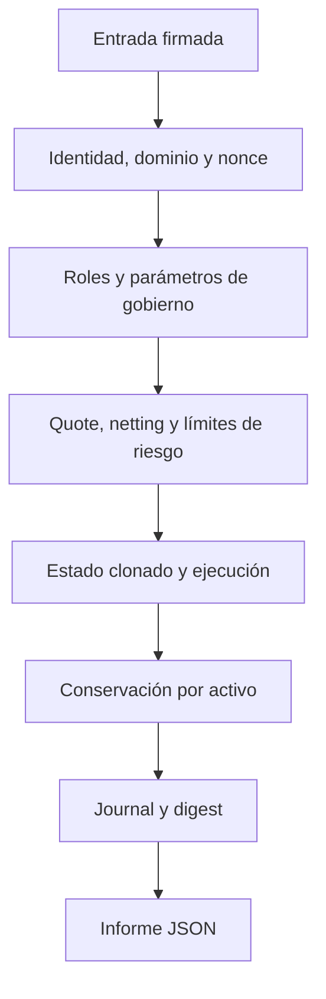

# Política de seguridad de NexusDTL

## Fronteras de confianza

El motor recibe intents y batches firmados, observaciones de oráculo y operaciones de bóveda a través de escenarios locales. Las identidades Ed25519 y los digests canónicos vinculan datos de autorización; los roles de coordinador, solver, publicador de oráculo, administrador de riesgo y tesorería separan funciones. Los informes JSON describen estado, pero no son por sí solos credenciales ni permisos.



## Invariantes y controles de revisión

- Un batch no debe aplicarse dos veces ni reutilizar transacciones o nonces.
- Los flujos de netting deben equilibrar débitos y créditos por activo.
- La suma de saldos, reservas y movimientos internos debe conservar el suministro de cada activo.
- La evaluación de riesgo comprueba notional, fees de solver, utilización, número de facilities y reserva mínima proyectada.
- Las operaciones de vault distinguen shares activas, shares bloqueadas y tickets pendientes; cualquier cambio de fórmula requiere revisar el valor económico de todas las posiciones.
- Los cambios de estado se registran en el journal y modifican el digest reproducible.

Estas son propiedades sujetas a pruebas y revisión, no una certificación de ausencia de defectos. La lectura de estrés es informativa y no reemplaza los límites de admisión.

## Validación exigida

```bash
npm ci
bash scripts/ci.sh
```

El pipeline comprueba Rust 1.96 con formato, build, tests y Clippy, además de sintaxis JavaScript, Prettier y contratos de la CLI. Dependabot revisa Cargo, npm y Actions. Una modificación de liquidación, reserva, crédito, ticket o firma debe incluir un caso nominal y un caso de rechazo o límite económico.

## Reporte privado

No publique datos sensibles ni una secuencia de abuso en issues públicas. Utilice el mecanismo de reporte privado de seguridad de GitHub del repositorio si está disponible. Aporte versión y commit, precondiciones, secuencia mínima, estado inicial, resultado observado, resultado esperado e impacto económico estimado. La documentación y los problemas de integración sin contenido sensible pueden tratarse mediante issues ordinarias.
