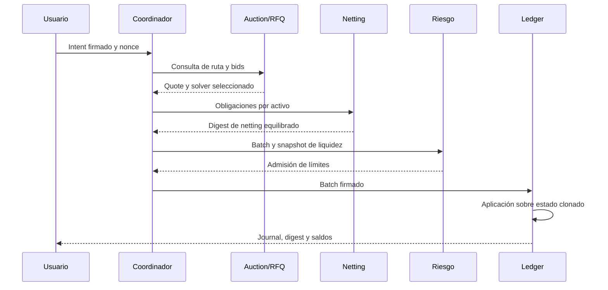

# Arquitectura de ejecución

NexusDTL mantiene un estado en memoria con mapas ordenados para activos, cuentas, vaults, facilities y operaciones ya procesadas. La serialización canónica evita que un mismo objeto económico admita representaciones divergentes antes de firmar o calcular un digest. El journal almacena las transiciones aceptadas en orden.

## Identidades y objetos

`AccountId`, `AssetId`, `VaultId`, `IntentId`, `BatchId` y `TxId` son tipos distintos. Los identificadores y digests se derivan de dominios explícitos para impedir cruces accidentales entre objetos. Los intents y batches tienen firmas separadas: el usuario autoriza su intención y el coordinador autoriza la agrupación ejecutable.

## Subsistemas

- `governance/` mantiene roles y parámetros de operación.
- `oracle/` registra publishers y observaciones por mercado.
- `auction/` administra lanes y bids de solver; `market/` define intents, quotes y batches.
- `netting/` compone obligaciones y exige equilibrio por activo.
- `risk/` evalúa límites de batch y proyecciones de liquidez de solo lectura.
- `vault/` gestiona reserva, participaciones, posiciones y tickets de salida.
- `credit/` controla facilities, principal e interés; `treasury/` registra fees y seguro.
- `ledger/` confirma cambios y mantiene el journal y los digests.

La CLI (`runtime/`) crea escenarios deterministas y no abre sockets. Los adaptadores de red, custodia y persistencia quedan fuera de esta distribución. Para introducirlos, una integración tendría que fijar la semántica de reloj, reintentos, idempotencia y recuperación del journal antes de aceptar tráfico externo.
