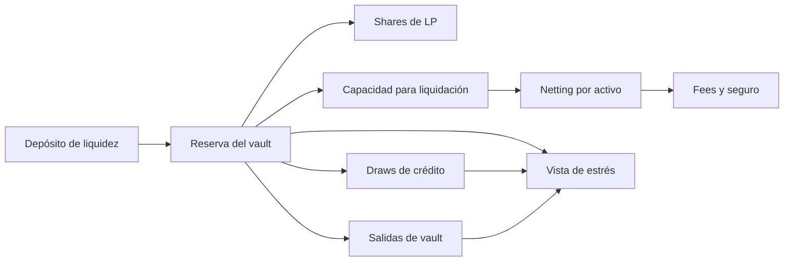

# Modelo económico

Los importes son enteros `u128` en unidades mínimas del activo. `Bps` representa puntos básicos entre 0 y 10.000. Cada activo tiene escala declarada; `NXUSD` y `NXBOND` usan seis decimales en los escenarios de ejemplo. No se redondea con coma flotante.



La vista de estrés del release usa solo la reserva actual del vault; las flechas de crédito y salidas indican factores que deben revisarse junto con ella, no que el módulo de estrés los descuente automáticamente. Esta distinción evita interpretar un colchón de caja como solvencia total.

## Participaciones y tickets

En el primer depósito se emite una share por unidad mínima depositada. En depósitos posteriores, la emisión depende del ratio entre shares existentes y reserva actual. Una solicitud de salida mueve shares de la posición activa a la bloqueada y crea un ticket ejecutable tras el retraso configurado. Las posiciones, tickets, reserva y fees son magnitudes distintas: un informe de conservación no sustituye la valoración de cada derecho económico.

## Admisión de batch

Para un batch, el motor compara entrada y salida brutas con `max_batch_notional`, fees del solver con su límite y facilities abiertas con su máximo. Calcula `projected_reserve = reserve_balance - gross_output` mediante aritmética comprobada; si queda por debajo de `min_reserve_after_batch`, rechaza la operación. La utilización del batch se expresa en bps respecto a la reserva previa.

El netting agrega débitos y créditos por activo y exige que sean iguales en el reporte. La tesorería calcula claims de protocolo y seguro sobre notional mediante bps; su contabilización queda registrada junto a la liquidación.

## Ventanas de estrés

```text
reserva_estresada = floor(reserva × (10.000 - haircut_bps) / 10.000)
pérdida_de_choque = reserva - reserva_estresada
colchón = max(0, reserva_estresada - reserve_floor - pending_fees)
```

Con reserva de `90.000.000.000`, `reserve_floor` de `8.000.000.000` y fees pendientes cero, un haircut del 10 % deja `81.000.000.000` de reserva estresada y `73.000.000.000` de colchón. Con el 25 %, las cifras son `67.500.000.000` y `59.500.000.000`. La vista informa también si el mínimo operativo queda cubierto. Estos números no autorizan un batch ni garantizan que las obligaciones crediticias o de salida estén valoradas; son una sensibilidad de reserva.
